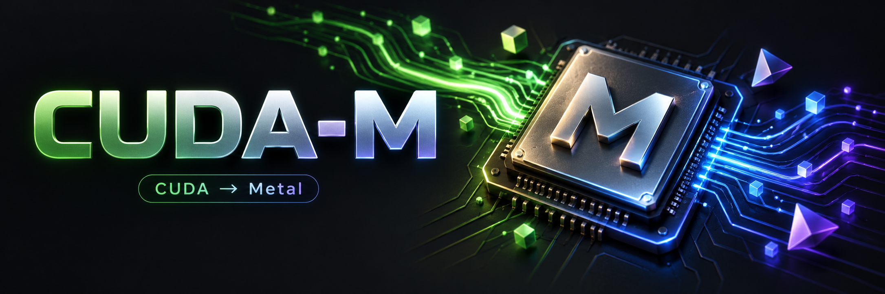
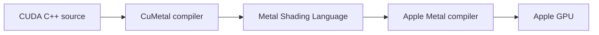

# CUDA-M

<p align="center">
  
</p>

<p align="center">
  <strong>Run supported CUDA kernels on Apple Silicon.</strong><br>
  Experimental CUDA-to-Metal compatibility, built on CuMetal.
</p>

<p align="center">
  <a href="#quick-start">Quick start</a> ·
  <a href="#verified-on-an-m1">M1 results</a> ·
  <a href="local/EVIDENCE.md">REA evidence</a> ·
  <a href="docs/known-gaps.md">Known limits</a>
</p>

CUDA-M brings together the [CuMetal compiler and runtime](https://github.com/Lulzx/cuda-metal),
a local build runner, Metal toolchain discovery, and independent GPU correctness
checks. Write ordinary CUDA C++, compile it into Metal, and run supported kernels
on your Mac's GPU.

**Verified on Apple M1:** six GPU launches passed numerical checks, including
matrix multiplication and shared-memory reduction. REA captured CUDA launch
calls reaching Apple's Metal compute driver. See the
[dated verification report](local/EVIDENCE.md) for scope and evidence.

## Quick start

Requires Apple Silicon, macOS 14+, Xcode with Apple's Metal tools, Python 3.8+,
CMake, Ninja, LLVM, LZ4, and Zstd. The local build defaults to Homebrew LLVM.

```bash
git clone --recurse-submodules https://github.com/lalomorales22/CUDA-M.git
cd CUDA-M

./cuda-mac build
./cuda-mac test
```

On a machine missing the build dependencies:

```bash
brew install cmake ninja llvm lz4 zstd python
xcodebuild -downloadComponent MetalToolchain
```

See the [setup guide](local/README.md) for the Xcode launcher workaround verified
on this Mac and alternate LLVM configuration. The build uses two jobs and keeps
the compiler and runtime inside the checkout.

## Your first CUDA program

The included example has CUDA memory calls, a `__global__` kernel, and an ordinary
`<<<blocks, threads>>>` launch.

```bash
./cuda-mac compile samples/vectorAdd/vectorAdd.cu -o local/out/vector-add
CUMETAL_TRACE_GPU=1 ./local/out/vector-add
```

Expected numerical result:

```text
PASS: samples/vectorAdd produced correct output for 16384 elements
```

The trace also identifies the Apple GPU and successful kernel completion.
For another source file, use `./cuda-mac compile your-file.cu -o your-program`.
Keep the checkout in place: compiled programs link to its local runtime.

## Verified on an M1

| CUDA workload | Checked locally |
| --- | --- |
| Vector addition | Every one of 16,384 outputs |
| SAXPY | Sizes 1, 257, and 100,003; partial thread blocks |
| Matrix multiplication | 37×29 times 29×41; all 1,517 outputs; 2D blocks |
| Shared-memory reduction | 100,003 inputs; 391 GPU block sums; barriers |
| Output boundaries | 512 untouched tail values after each independent case |

The runner requires both correct numerical output and completed Apple-GPU trace
records. It rejects missing work, failed launches, approximate results, and CPU
execution. The reduction's final accumulation runs on the CPU after every GPU
block sum is checked.

- [Complete CUDA test source](local/apple_silicon_smoke.cu)
- [Committed numerical results](local/verification/2026-10-08/results.json)
- [REA observations and limitations](local/EVIDENCE.md)
- [Portable REA evidence summary](local/verification/2026-10-08/rea-summary.json)

These checks establish the selected kernels' correctness. They are not a
performance benchmark or the full upstream conformance suite. M4 execution has
not been verified by this project.

## How it runs



CuMetal provides the compiler and CUDA-facing runtime. CUDA-M adds the local
workflow, toolchain wrapper, independent validation fixture, and recorded M1
evidence. The runtime and compiler source are unchanged from the pinned upstream
revision.

## Commands

| Command | Purpose |
| --- | --- |
| `./cuda-mac build` | Build the local compiler, runtime, and helpers |
| `./cuda-mac doctor` | Check dependency discovery |
| `./cuda-mac test` | Compile and numerically validate six GPU launches |
| `./cuda-mac compile input.cu -o output` | Compile supported CUDA source |
| `python3 local/test_trace_validation.py` | Check rejection of misleading GPU evidence |

Generated executables, caches, and raw machine-specific logs stay in ignored
build/output folders. A small dated verification snapshot is included in Git.

## Compatibility boundaries

This is an experimental source-compilation workflow. Arbitrary CUDA applications,
PyTorch's CUDA backend, NVIDIA SASS binaries, tensor-core instructions, and
complete CUDA library compatibility are outside the verified scope. Some upstream
library paths use the CPU. Apple GPUs do not provide native NVIDIA FP64 semantics.

Read the [upstream known gaps](docs/known-gaps.md) before choosing a workload.
The optional binary compatibility alias is disabled in this Release build.

## Credit and license

The compiler/runtime foundation is **[CuMetal by Lulzx and its contributors](https://github.com/Lulzx/cuda-metal)**.
This repository preserves its Git history and [Apache-2.0 license](LICENSE).
CuMetal revision: `fdf403ebdd14a57565fd167d675e2a9910a72c35` (0.6.0).

The [original upstream README](UPSTREAM_README.md), [specification](spec.md),
and [documentation](docs/README.md) remain available. Upstream functionality and
upstream benchmark claims should be read with their original scope.

The custom banner was made with the built-in image generation tool;
[artwork details and exact prompt](assets/readme/GENERATED.md) are included.
CUDA-M is an independent project and is not affiliated with NVIDIA or Apple.
